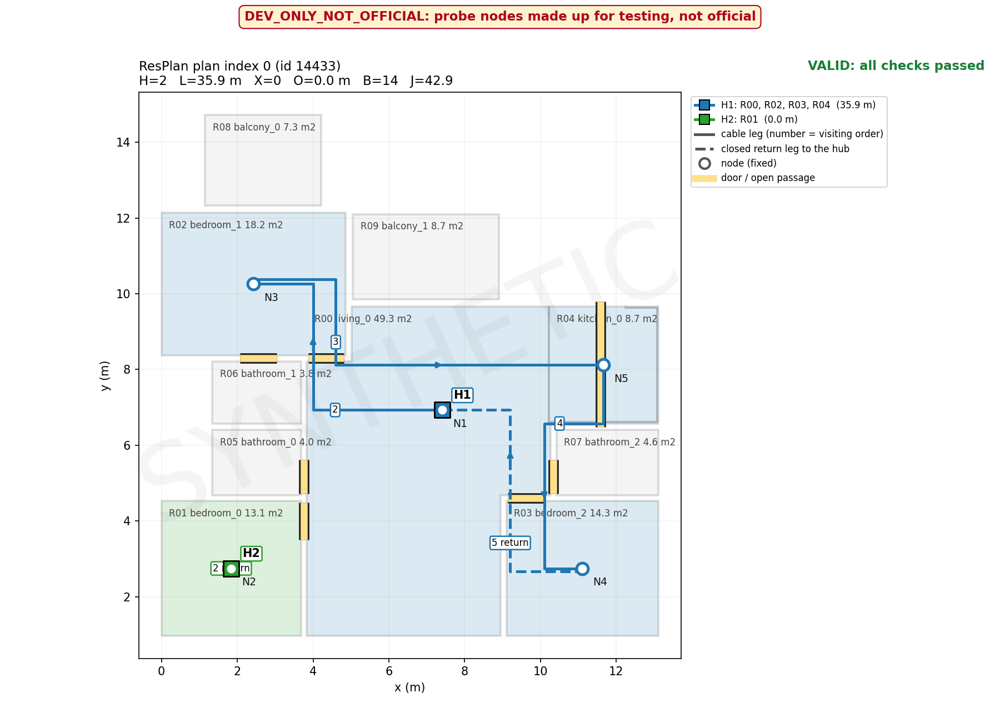

# Control-Panel Placement and Closed-Loop Cable Routing

**Team Shyena · Computational geometry, graph algorithms, and constrained optimization**

A Python research prototype that interprets residential floor plans, assigns eligible rooms and fixed device nodes to control panels (hubs), and constructs obstacle-aware, closed-loop cable routes. Originally developed for a Honeywell hackathon challenge.

> **Status:** Development prototype. Results below use generated test nodes, **not** organiser-provided fixed nodes or an official checker. This is not an electrical installation design.

## What it does

1. Parses ResPlan geometry and converts drawing units to metres.
2. Identifies eligible rooms and door/open-passage connectivity.
3. Groups rooms under hub capacity and connectivity constraints.
4. Selects hub positions and node visiting orders.
5. Routes horizontal/vertical cable legs through legal free space.
6. Validates the resulting rings, computes cost metrics, and generates JSON and a floor-plan overlay.

**Pipeline:** ResPlan input → geometry → room graph → hub assignment → hub placement → node ordering → grid routing → validation → JSON + PNG.

## Constraints and objective

Each eligible living room, bedroom, kitchen, or storage room has one node. Every eligible room/node must be assigned exactly once; no individual room is split. Each hub supports **at most 100 m² of eligible-room area and 5 nodes**. Its assigned territory must be connected through doors/open passages. Hubs must be inside an assigned eligible room and at least **0.5 m from walls**. Every cable ring must start and end at its own hub, visit each assigned node exactly once, use axis-aligned segments, and avoid walls, windows, and external space.

Valid solutions are ranked **first by hub count**, then by

`J = L + 5X + O + 0.5B`

where `L` is total cable length in metres (including returns), `X` is crossings, `O` is overlapping cable length in metres, and `B` is bends. A smaller assigned-area gap breaks remaining ties.

## Implementation

- **Geometry:** Shapely polygon repair, room extraction, scale conversion (`sqrt(inner.area / area)`), gates and adjacency.
- **Assignment and hub placement:** Capacity-constrained connected partitions, exact search for small instances with a greedy fallback, candidate hub positions, and routing-aware refinement.
- **Routing:** Node-order search and grid-based obstacle-aware pathfinding, followed by closed-loop construction.
- **Validation:** Constraint checks and recomputation of metrics from route polylines.

The repository includes both earlier modules and later integration adapters. In particular, `run.py` uses `geometry.py`, `adapter_person_c.py`, `assign.py`, and `panel_routing/`; the `person_b/` directory preserves optimization modules and tests. Other geometry contracts/adapters are retained for development and comparison.

## Setup

Python 3.10+ is recommended for the documented development setup.

```bash
git clone https://github.com/murf-xd/Join-optimization-of-control-panel-placement-
cd Join-optimization-of-control-panel-placement-
python3 -m venv .venv
source .venv/bin/activate
python -m pip install 'numpy>=2,<3' shapely networkx matplotlib pytest
python -m pytest -q
```

The ResPlan dataset is **not bundled**. Obtain `ResPlan.pkl` separately from the dataset source and supply its path in the commands below. Only load pickle files from trusted sources.

### Run a development example

```bash
python run.py --index 0 --pkl /path/to/ResPlan.pkl --dev-probe-nodes
```

To convert the first ResPlan record to a JSON geometry file, `convert_resplan.py` is provided. Its current source path assumes `~/Downloads/ResPlan.pkl`; adjust that path if necessary. Once converted:

```bash
python run.py --json resplan_json/plan_0.json --dev-probe-nodes
```

The `--dev-probe-nodes` flag is essential for these demonstrations: the public ResPlan data does not supply the organisers' fixed device coordinates. Generated outputs are labeled `DEV_ONLY_NOT_OFFICIAL` and written under `out_dev/`. **Do not submit them as official results.**

### Batch development smoke test

```bash
python smoke_real.py --pkl /path/to/ResPlan.pkl --adapter adapter_person_c --n 50 --full
```

This produces `out_dev/DEV_ONLY_NOT_OFFICIAL_smoke.csv`. It uses genuine ResPlan geometries but generated test nodes, and its validity is determined by the project's development validator.

## Recorded development results

The team reported **43 automated tests passing** after adding JSON input support. A 50-plan development smoke test on genuine ResPlan geometries reported:

| Outcome | Plans |
| --- | ---: |
| Valid under development validator | 47 |
| Invalid | 2 |
| Pipeline error | 1 |
| **Total** | **50** |

This is a **94% development validation rate**, **not** an official benchmark score or evidence of performance on unseen organiser inputs. In one checked example (ResPlan ID 14433), PKL and converted JSON runs produced matching reported metrics: 2 hubs, `L ≈ 35.87 m`, `X = 0`, `O = 0`, `B = 14`, and `J ≈ 42.87`.

### Known cases

- **Plan index 5:** A single eligible room is approximately 107.26 m², exceeding the per-hub capacity. The design must be reported infeasible rather than considered valid.
- **Plan index 24:** An eligible room has no usable free-space geometry for development node placement.
- **Plan index 25:** An apparent room connection is not routable on the current geometry/grid; the router skips one assigned node and the validator correctly rejects the incomplete ring.

## Geometry assumptions and limitations

| Assumption | Current interpretation |
| --- | --- |
| Open-passage width | Nominal threshold 0.7 m |
| Rescue opening threshold | 0.4 m for selected otherwise-disconnected cases; requires careful validation |
| Minimum clear gate width | 0.2 m |
| Windows | Routing barriers |
| Hub-to-window clearance | 0.5 m, conservative project assumption |
| Balconies | External, excluded from interior routing |
| Bathrooms | No nodes or hubs; cables may traverse legal openings, while assignment-territory pass-through remains an interpretation to verify |

The converted ResPlan JSON preserves geometry but is **not guaranteed to match the organisers' official JSON schema**. Fixed-node ingestion, coordinate-frame conventions, and independent official-checker compatibility remain unverified. The optimizer searches a limited candidate space; it does not guarantee a global minimum routing cost. Source geometry may contain ambiguous openings or inaccessible rooms.

## Project structure (selected files)

```text
geometry.py / geometry_v2.py    Geometry extraction and analysis
adapter_person_c.py            Geometry-to-routing-plan adapter
contract_v2.py                 Shared geometry-side contract
assign.py                      Integrated room assignment
person_b/                      Optimization modules and tests
panel_routing/                 Routing, metrics, JSON, validation
run.py                         Single-plan pipeline (PKL / JSON)
smoke_real.py                  Multi-plan development smoke test
convert_resplan.py             PKL-to-JSON geometry conversion
visualize.py                   Floor-plan overlay generation
tests/                         Automated tests
```

## Next steps

Priorities are reproducible official-format input support, validation against fixed nodes, investigation of geometry/routing failures, a clean benchmark with runtime and cost reporting, and additional regression tests. Optimize further only where measured results justify it.

## Credits

**Team Shyena:** Ayanna Mahajan, Vandita Aeri, and Mansi Sharma. Developed collaboratively across geometry processing, hub assignment/optimization, and routing/visualization.

## Disclaimer

Educational research prototype only. It has not been certified for real electrical installation or validated by the organisers' official checker.

## Project Demonstration

**Plan 14433 — Development Demo**



*Generated using genuine ResPlan geometry with development-generated nodes. Not an official benchmark result.*
